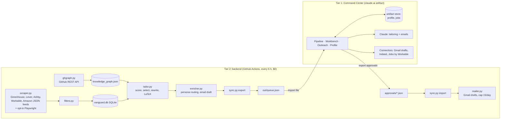

# Project Vanguard: architecture

A human-in-the-loop job search engine for entry-level software and applied AI roles in London.
The machine finds, filters, scores, tailors and drafts. A human approves every application and every email.
Nothing is sent or submitted automatically.

## 1. System



Both tiers run the same deterministic scorer (`config/skills_lexicon.json`), so a JD gets the same score in the page and in the backend. Verified: the sample JD in `tests/` scores 71.21% in both.

The two tiers can each run alone. The Command Center alone covers the whole loop for jobs you paste or find through connectors. The backend adds unattended discovery across company boards.

## 2. Data schemas

**SQLite (`vanguard/db.py`)**: `companies`, `jobs`, `tailorings`, `contacts`, `outreach`, `runs`. Full DDL with comments is in `vanguard/db.py`.

Job states: `scraped → filtered_out | pending_approval → approved → applied → cold_email_drafted → cold_email_sent → interviewing | rejected | offer`.

**Candidate Knowledge Graph (`data/knowledge_graph.json`)**

```json
{
  "candidate": {"name", "github", "right_to_work", "experience": [...], "education": [...], "commercial_swe_years": 0},
  "projects": [{
    "id", "name", "repo", "demo", "years", "flagship", "on_resume",
    "skills":   ["kotlin", "room", "openrouter", ...],
    "features": ["Concrete, checkable statements of what was built"],
    "metrics":  ["12 GitHub stars", "178 KB gzipped JS budget per route"],
    "problem_solution": [{"problem", "solution"}],
    "auto_evidence": {"languages", "dependencies", "recent_commits", "pushed_at"}
  }]
}
```

**Artifact store** (`profile/main`, `jobs/{id}`): the page's copy of the profile and the pipeline. Readable and writable only by you (access rules: admin and owner).

**Bridge files**: `out/queue.json` (backend → page) and `approvals-YYYY-MM-DD.json` (page → backend). Shapes are in `sync.py`.

## 3. Execution pipeline (one cron run, `run.py`)

1. **Ingest** GitHub: repos, READMEs, manifests, last 30 commit messages. Merges into the graph and never deletes what you wrote by hand.
2. **Scrape** every enabled company's public board feed. One broken board is logged and skipped.
3. **Filter**: title must be a target role family; senior titles dropped unless they also say graduate/junior/associate; London or UK; parsed "N years" ≤ 3; no SC/DV clearance; optional no-sponsorship drop.
4. **Tailor** (≤ 25 per run): JD keywords, base score, company cap (2 approved per company per 30 days), top 3–4 projects by weighted overlap, bullets, LaTeX, PDF if tectonic is installed, after score.
5. **Enrich**: persona by company size, LinkedIn search links, email pattern (Hunter.io if keyed), < 90-word email.
6. **Mail**: only rows a human approved, and only when the contact has an email. Creates Gmail drafts, at most 15 per UTC day.
7. **Export** `out/queue.json` and commit state back to the repo.

### The zero-hallucination guard

`vanguard/grounding.py` (and its JS twin) extracts every lexicon skill and every number from a rewritten bullet and checks it against that project's evidence. One unbacked term reverts the bullet to the original evidence text. The diff view shows which bullets were kept and why others were rejected. The cover letter and emails get the same check as warnings, and terms that come from the JD are marked as "theirs" (fine to name, not to claim).

Limit: the guard checks skills and numbers, not every verb. "Led a team of engineers" contains neither and would pass. The prompts forbid it and the diff makes it visible, but you are the final check.

## 4. Where the spec doesn't survive contact with reality, and what replaced it

| Spec says | Problem | What was built |
|---|---|---|
| Playwright scraper for Fortune 500 / FTSE 100 careers sites | Most enterprise boards sit on Greenhouse/Lever/Ashby/Workday, which publish JSON feeds. Browser scraping is slower, breaks on every redesign and often breaks the site's terms. | JSON feed adapters for Greenhouse, Lever, Ashby, Workable and Amazon. Playwright kept for one opt-in site with no feed (Google). |
| Scrape LinkedIn / find EMs automatically | Automated LinkedIn access breaks its User Agreement and gets accounts restricted. "Guess the EM's email" has a high bounce rate, and bounces damage your sender reputation. | A pre-filled LinkedIn people-search link per persona. You pick the person (about 30 s), then enter the email from the company's pattern. |
| `window.claude.complete()` | Doesn't exist in published artifacts. | The artifact's `sample` capability (Claude runs inside your plan, no API key). |
| Artifact as a live UI over the backend's SQLite | An artifact cannot reach your machine or GitHub. | File bridge: import `queue.json`, export approvals. The page also runs the full loop on its own via connectors. |
| ATS cosine similarity "mathematically" | Real ATS systems mostly do keyword search and knockout questions. Cosine over a JD is a proxy, not what the recruiter's software computes. | Weighted keyword coverage (what keyword filters approximate) is the headline score. Cosine is in `keywords.py` for comparison. |
| "Max 2 applications per company to avoid ATS spam flags" | Greenhouse/Workday don't flag volume. The real risk is a recruiter seeing five near-identical applications from you. | Kept the cap, enforced at approval time, for that reason. |
| $0/month | True for GitHub Actions, the page and Gmail. Backend Claude rewrites need an Anthropic API key, which is paid. | The backend runs deterministic (no rewriting) without a key; the page does the writing for free. |
| PDF from the artifact | No LaTeX compiler in a browser sandbox. | `.tex` download or copy → Overleaf, or the backend compiles with tectonic. |

## 5. The bigger picture (read this before tuning the machine)

The bottleneck is the quality of what gets submitted, not how many submissions go out. For this profile:

- **Commercial SWE experience is zero.** The current role is IT support. In London 2026 junior hiring, that loses most resume screens before keyword scores come into it. What gets past them is projects with users, contributions to other people's code (merged PRs to known open source), and referrals.
- **Right to work ends 30 June 2028.** Anything that becomes a long-term role will need Skilled Worker sponsorship by then. The filter flags "no sponsorship" postings. Weighting companies on the UK register of licensed sponsors would be a better use of a scraper than another job board.
- **Grad schemes run on a calendar.** Big Tech and banks mostly open graduate intakes from September to November for the next year. Mid-October is inside that window right now. Those are manual, one-off applications, and a scraper adds little to them.
- **Cold email works for startups and is weak for enterprise EMs.** At enterprise, an early-careers recruiter or a referral beats an EM cold email. Vanguard routes that way.
- **Tighten the evidence before writing more emails.** Kepler is the strongest engineering project but is off the current resumes, and few projects have a metric beyond stars. One deployed project with real users and a number to show for it would raise every score and every email this system writes.
